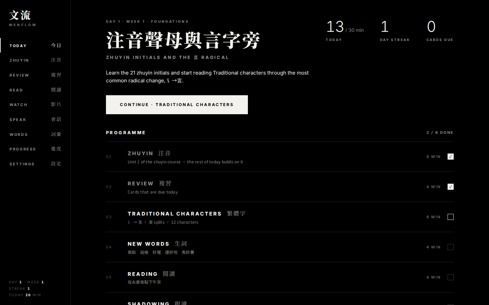
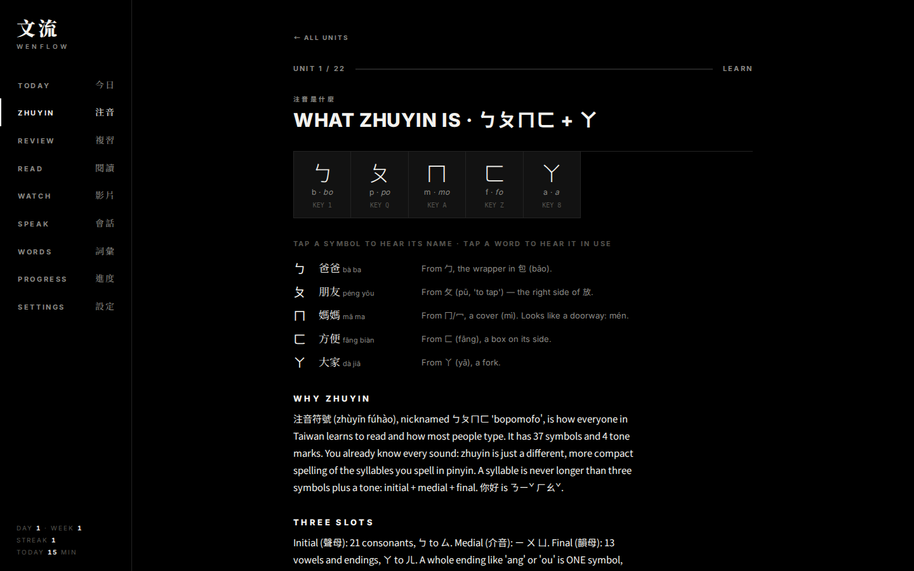
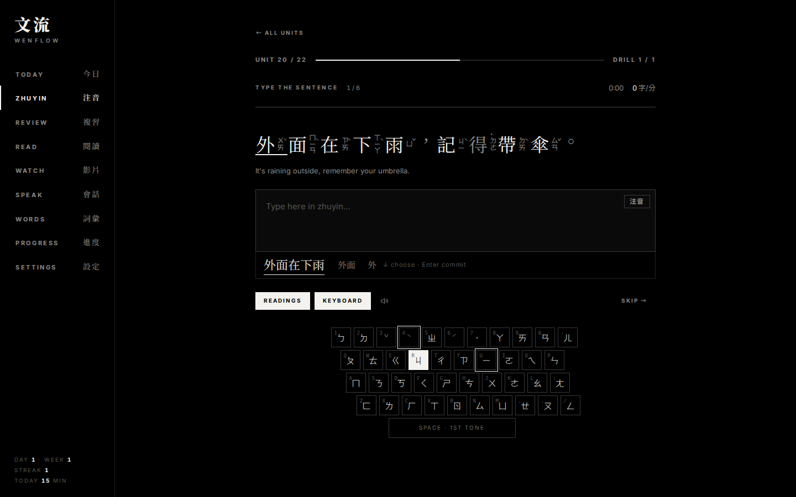
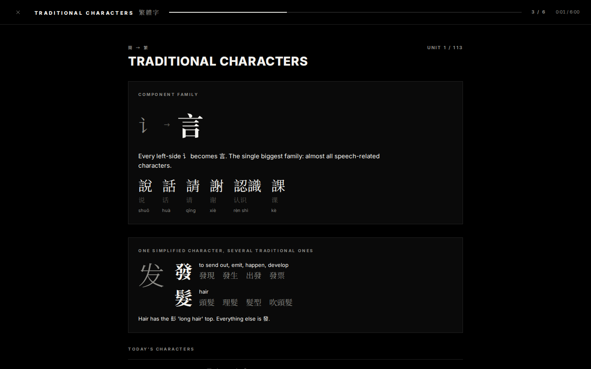
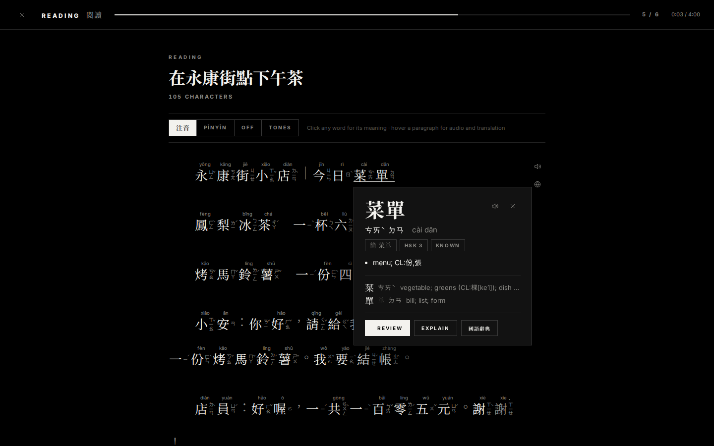
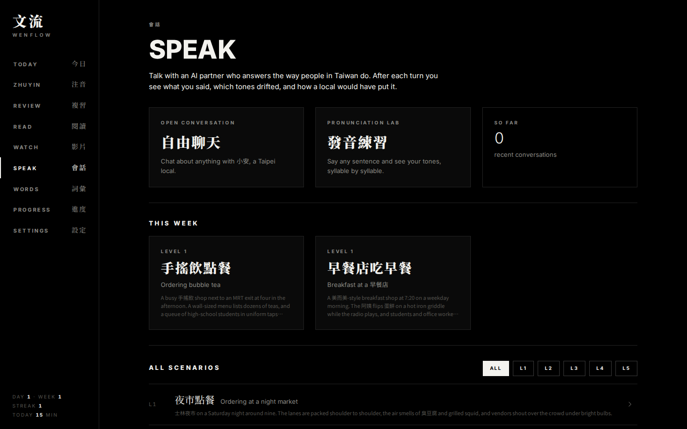
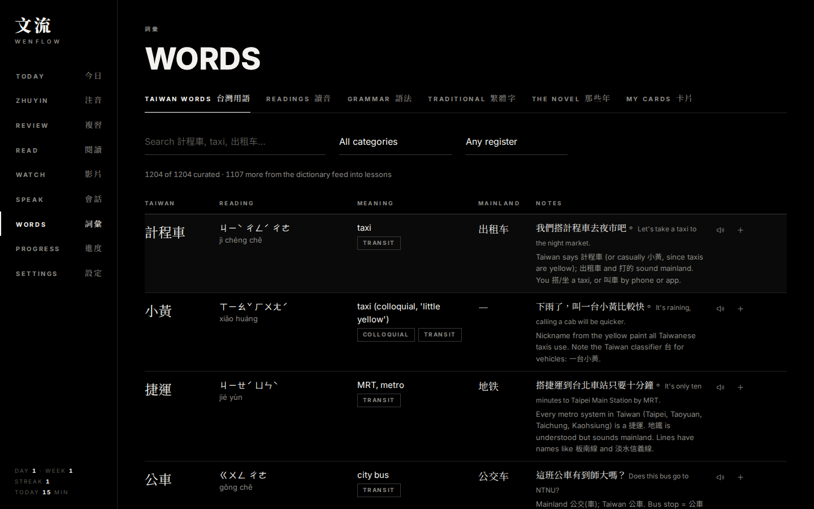
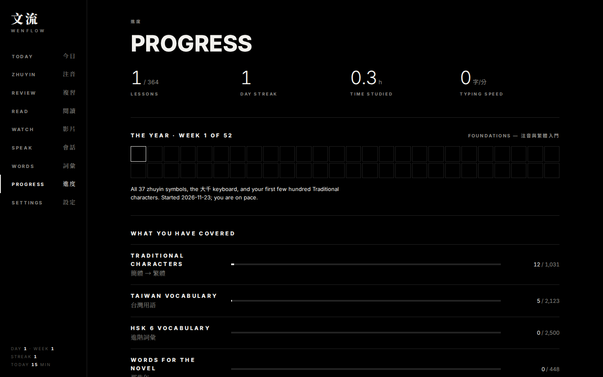
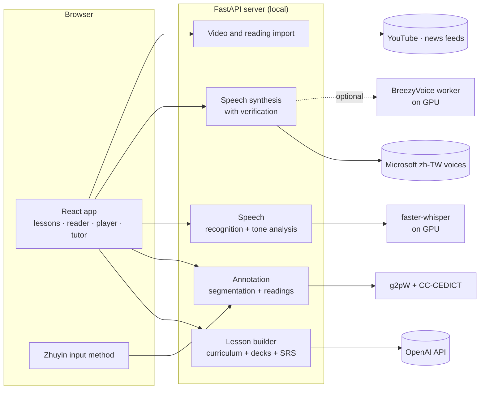

# 文流 Wenflow

A self-hosted course for switching from mainland Mandarin to **Taiwanese Mandarin**: Traditional
characters, 注音 (zhuyin / bopomofo) typing, Taiwan vocabulary and readings, and a Taiwanese accent —
one 30-minute session a day for a year.

It is built for one specific learner: someone at about HSK 5 who reads Simplified, wants to reach
HSK 6 level in Traditional, type in zhuyin, sound Taiwanese, and read the novel
《那些年，我們一起追的女孩》 along the way. It runs on your own machine as a local web app.



## Contents

- [What you get](#what-you-get)
- [The year and the day](#the-year-and-the-day)
- [Getting started](#getting-started)
- [Configuration](#configuration)
- [Voices](#voices)
- [Reading the novel](#reading-the-novel)
- [How it works](#how-it-works)
- [Accuracy and limits](#accuracy-and-limits)
- [What leaves your machine](#what-leaves-your-machine)
- [Project layout](#project-layout)
- [Development](#development)
- [Content, data and credits](#content-data-and-credits)
- [Licence](#licence)

## What you get

| Tab | What it does |
| --- | --- |
| **Today** 今日 | The day's programme: review, zhuyin, Traditional characters, new words, reading, listening, speaking, writing. The reading passage, practice sentences and writing prompt are written fresh each day around that day's words. |
| **Zhuyin** 注音 | 22 units from ㄅㄆㄇㄈ to timed typing on the 大千 layout, the full chart with audio, and typing practice with a built-in zhuyin input method. |
| **Review** 複習 | Spaced repetition. Traditional characters are written by hand and stroke-checked; Taiwan words are sometimes asked from the mainland word. |
| **Read** 閱讀 | Import a book (EPUB / MOBI / TXT / paste) or any article, plus live Taiwanese news feeds. Every word is clickable; readings switch between 注音, pinyin and none. |
| **Watch** 影片 | Any YouTube link or local file with synced, clickable captions. Uses the video's Chinese subtitles when it has them, otherwise transcribes locally. New videos from Taiwanese creators every day. |
| **Speak** 會話 | 51 role-play scenarios plus free talk with an AI partner, by button or hands-free. After each turn: what you said, clear tone slips, and how a Taiwanese speaker would put it. A pronunciation lab for single sentences. |
| **Words** 詞彙 | The reference: Taiwan vocabulary, Taiwan readings, grammar, the Simplified → Traditional rules, and the novel's vocabulary. |
| **Progress** 進度 | The 52-week plan, deck coverage, streak, typing speed. |

### Zhuyin, taught with the keyboard

Each symbol is learned together with its key, because the 大千 layout follows the chart column by
column. Tapping a symbol plays its name (bo, po, mo, fo …).



The built-in input method behaves like Microsoft 注音: symbols fill initial / medial / final slots,
a tone key ends the syllable, the run converts automatically, ↓ opens candidates, Enter commits.
You can practise typing before installing anything on your system.



**Every day is self-contained.** The zhuyin unit is the first block of the day, and nothing after it
asks for more zhuyin than the course has taught by then:

- A syllable keeps its pinyin above the character until every symbol in it has been taught. After
  unit 1, 爸 and 媽 stand on their zhuyin alone while 請 still shows *qǐng*; the pinyin drops away
  unit by unit and is gone once all 37 symbols are known (unit 10).
- Typing tasks wait for the keyboard: dictation starts once the tone keys have been taught (unit 13)
  and free writing once choosing between characters has (unit 16). Until then those slots hold
  reading and shadowing instead.
- A unit finished ahead of time in the Zhuyin tab is not repeated, and one that was left undone is
  never skipped.

### Traditional characters as rules, not a list

About 1,030 characters differ between Simplified and Traditional in the HSK 1–6 vocabulary. They are
taught in 113 small units: component families first (讠→言 covers dozens of characters at once), then
the one-to-many traps (发 → 發 / 髮), then the rest by frequency. Each one is written by hand.



### Text you can click

Readings are set the Taiwanese way — zhuyin stacked to the right of each character — or as pinyin, or
hidden. (The screenshot is from day 1, so pinyin is still shown above syllables whose symbols have
not been taught yet.) Click a word for its reading, its Simplified form, the dictionary entry, a Taiwan usage note,
an in-context explanation, or the Ministry of Education's Chinese definition.



### Speaking



The tutor stays in character and answers the way people in Taiwan talk. A second pass acts as the
teacher: it shows what was recognised, flags syllables whose tone clearly went wrong, and gives the
more natural Taiwanese phrasing with the reason (for example 外帶 rather than 打包帶走).

### The decks



| Deck | Size |
| --- | --- |
| Taiwan vocabulary, curated (cross-strait terms, slang, particles, Hokkien loans, set phrases) | 1,204 |
| Further Taiwan-tagged entries from CC-CEDICT | 1,107 |
| Words read differently in Taiwan | 335 |
| Grammar and usage points | 139 |
| Simplified → Traditional characters | 1,031 in 113 units |
| HSK 6 vocabulary, in Traditional | 2,500 |
| Companion vocabulary for the novel | 448, plus 13 culture notes |
| Role-play scenarios | 51 |
| Taiwanese YouTube channels for daily picks | 80 |
| Taiwanese news and article feeds | 40 |

## The year and the day



| Phase | Weeks | Focus |
| --- | --- | --- |
| 1 · Foundations 注音與繁體入門 | 1–4 | All 37 zhuyin symbols, the 大千 keyboard, the first few hundred Traditional characters |
| 2 · Daily life 台灣日常 | 5–16 | Food, transport, errands. Traditional reading becomes automatic; typing reaches about 30 字/分 |
| 3 · Taiwan flavour 台灣味 | 17–32 | School life, slang, media, relationships — the world of the novel. HSK 6 vocabulary in earnest |
| 4 · Advanced 進階與書面語 | 33–48 | Professional and literary Mandarin: news, argument, narration. The novel is finished |
| 5 · Mastery 總驗收 | 49–52 | Consolidation and final checkpoints |

Each week has a theme, goals, two or three scenarios and a checkpoint
([`curriculum.json`](server/wenflow/content/curriculum.json)). A day is six blocks of about 30
minutes in total. Zhuyin always opens the day — a unit of the course at first, a typing warm-up or
dictation once the course is finished — and the rest of the mix rotates through the week so that
every skill comes round:

| | Typical blocks |
| --- | --- |
| Most days | Zhuyin or typing · review · Traditional characters · new words · reading · shadowing |
| Twice a week | Grammar · a video · writing with correction |
| Twice a week | A role-play conversation · Taiwan pronunciation |
| Once a week | Checkpoint quiz · the novel |

Lessons advance one at a time rather than by the calendar, so a missed day never skips material.

## Getting started

### Requirements

- **Linux or WSL2.** It was developed on WSL2 (Ubuntu). The Python dependencies include Linux CUDA
  libraries, so macOS and native Windows are untested.
- **Python 3.12** with [uv](https://docs.astral.sh/uv/), and **Node 20+**.
- **An OpenAI API key**, used for the daily material, the tutor and writing feedback.
- **An NVIDIA GPU is recommended**, not required. Speech recognition uses it when present and falls
  back to the CPU (slowly).
- **Disk:** about 3 GB for the speech and reading models. The optional local voice adds about 10 GB.

### Install and run

```bash
git clone https://github.com/rabbitnikodym/wenflow.git
cd wenflow
echo "OPENAI_API_KEY=sk-..." > .env
./run.sh
```

Then open <http://localhost:8000>.

`run.sh` installs the Python environment (`uv sync`), builds the web app, and starts the server on
`127.0.0.1`. The first start also:

- builds the dictionary from CC-CEDICT and the HSK lists (a few seconds),
- downloads the reading model (about 600 MB) and the speech-recognition model (about 1.6 GB),
- records the 37 zhuyin symbol names.

The first lesson of each day takes about 20 seconds to compose. The microphone only works on
`localhost` or over HTTPS.

## Configuration

Everything is optional except the key. Put these in `.env`:

| Variable | Default | Meaning |
| --- | --- | --- |
| `OPENAI_API_KEY` | — | Required for lessons, tutor and writing feedback |
| `WENFLOW_LLM_MODEL` | `gpt-6.2-sol` | Chat model for lessons, tutor, feedback. Any chat-completions model with JSON output works; it can also be changed in Settings |
| `WENFLOW_LLM_FAST_MODEL` | same | Model for quick look-ups (explain, translate, hints) |
| `WENFLOW_WHISPER_MODEL` | `large-v3-turbo` | faster-whisper model for speech recognition |
| `WENFLOW_WHISPER_DEVICE` | `auto` | `auto`, `cuda` or `cpu` |
| `WENFLOW_TTS_VOICE` | `zh-TW-HsiaoChenNeural` | Default cloud voice |
| `WENFLOW_DATA_DIR` | `./data` | Where progress, caches and models are kept |
| `WENFLOW_VOICE_PORT` | `8011` | Port of the local voice worker |
| `PORT` | `8000` | Port of the app (read by `run.sh`) |

In-app settings: readings (注音 / pinyin / off), pinyin support while you learn zhuyin, tone colours, whether to show Simplified forms, the
character typeface (明體 / 黑體 / 楷體), black or white theme, voice and speed, and the built-in
zhuyin keyboard.

## Voices

Audio can come from two places, chosen in Settings:

- **Microsoft zh-TW voices (cloud)** — 曉臻, 曉雨, 雲哲. Instant, and the default.
- **BreezyVoice (local, optional)** — [MediaTek Research's](https://github.com/mtkresearch/BreezyVoice)
  open Taiwanese-Mandarin voice, generated on your own GPU:

  ```bash
  server/voice/install.sh
  ```

  That installs it into `data/voice/` with its own Python environment (about 10 GB, 2.5 GB of GPU
  memory). The app then starts it by itself and it becomes the default voice. Because a generative
  voice occasionally drops or garbles words, **every clip is checked before it is kept**: a speech
  recogniser must hear the right syllables, short items must not carry a confidently wrong tone,
  and a failed clip is regenerated up to four times before the app falls back to the Microsoft
  voice for that item. A single character is spoken the way people cite one in Taiwan —
  「馬，馬上的馬」 — because such a model is unreliable on one bare syllable. New text takes one to
  four seconds the first time and is instant afterwards; a lesson's audio is prepared in the
  background when the lesson opens.

Three corrections apply whichever voice is used:

- **Symbol names** (bo po mo fo, de te ne le …) are fixed recordings.
- **Single characters** are pitch-checked against the tone they should carry, and re-recorded in a
  different frame if the voice bent it (a lone 媽 otherwise comes out rising).
- **Words the cloud voices read the mainland way** (椰子, 悄悄, 擁抱 …) are respelled before
  synthesis ([`tts_respell.json`](server/wenflow/content/tts_respell.json)).

## Reading the novel

The text of 《那些年，我們一起追的女孩》 is **not included** — it is under copyright. Add your own
copy in **Read** as an EPUB, Kindle (MOBI / AZW3) or text file, or paste it; Simplified copies are
converted to Traditional, and text that a converter cut into fixed-width lines is put back into
paragraphs. Copy-protected (DRM) files are refused, not unlocked. The app then splits it into chapters, works out which words you do not know yet, feeds
them into your daily lessons in reading order, and serves the book a passage at a time.

Before you import it, lessons still teach the 448-word companion deck (school life, banter, romance,
narration) and fill the book slot with an original short story that uses that vocabulary.

Any other book works the same way.

## How it works



- **Readings.** Every piece of Chinese on screen goes through one pipeline: jieba segmentation,
  then [g2pW](https://github.com/GitYCC/g2pW) (a polyphone model trained on Taiwan Mandarin) for
  context-aware readings, then Taiwan post-processing — curated word readings, characters read
  differently in Taiwan, and full tones where Taiwan does not use the neutral tone. So 頭髮 is
  ㄊㄡˊ ㄈㄚˇ, 星期 is ㄒㄧㄥ ㄑㄧˊ, and 得 / 地 / 長 / 行 are read in context.
- **Lessons.** `curriculum.py` turns a lesson number into a week and a day shape; `lessons.py` picks
  what is next from each deck, asks the language model for a passage, sentences and a prompt built
  around those words, and stores the plan. New items become review cards due the next day.
- **Input method.** `dictionary.py` builds a zhuyin index from CC-CEDICT and corpus frequencies and
  converts a run of typed syllables with a unigram word model. In drills the target sentence is
  known, so correct zhuyin yields the right characters, as a full input method would with context.
- **Tones.** Recognised characters are aligned to the audio, syllable boundaries are found by
  dynamic programming over intensity and voicing, and a small neural classifier
  ([`train_tone_model.py`](server/scripts/train_tone_model.py)) reads each pitch contour. Third-tone
  sandhi is word-aware (老闆你好 → 2-3-2-3).
- **Videos.** yt-dlp fetches the video's own Chinese subtitle track; if there is none, the audio is
  transcribed locally. Each video is graded by the share of words you know.
- **Storage.** SQLite in `data/` for progress and caches. Nothing personal is in the repository.

## Accuracy and limits

This is a personal project. The checks below were run with synthetic speech and a headless browser;
none of it has been evaluated on recordings of real learners.

- **Tone feedback is deliberately conservative.** The classifier is right on 62–82% of syllables for
  voices it has not heard. Only high-confidence mismatches are shown as errors: on native speech
  those are wrong 1–4% of the time, and they catch roughly a quarter of wrong tones. Treat a flag as
  "listen again", not as a verdict.
- **The built-in input method** picks the right characters about 94% of the time in free writing,
  with no sentence context. Press ↓ to choose another, as in a real input method.
- **The local voice** passed verification on 35 of 36 test sentences and 29 of 32 single characters.
  On words whose tone differs between Taiwan and the mainland it used the Taiwan tone about 76% of
  the time by the classifier above, against 84% for the Microsoft voice — within that classifier's
  error, so no evidence that either is more accurate. Its pronunciation marks nudge rather than
  force a reading.
- **The decks** in `server/wenflow/content/` were drafted with language-model assistance and
  machine-checked (valid readings, Traditional forms, example contains the headword; the
  pronunciation list was checked against the Ministry of Education dictionaries). They have not been
  reviewed by a native-speaking editor.
- **The curriculum is a plan.** It is paced for HSK 6 in a year at 30 minutes a day; nothing
  guarantees the outcome.
- **Single user, no login.** The server binds to `127.0.0.1`. Do not expose it to a network.

## What leaves your machine

| Goes to | What | When |
| --- | --- | --- |
| OpenAI | Word lists and the week's theme; your tutor turns as text; writing you submit; words you ask to have explained or translated | Lessons, tutor, feedback |
| Microsoft (Edge read-aloud service) | The text to be spoken | When a Microsoft voice is used, or as fallback |
| YouTube | Requests for video details, captions and audio | Watch |
| moedict.tw | The word you look up | 國語辭典 button |
| News sites, Google Fonts, jsDelivr | Feed and page requests; fonts; stroke-order data | Read, page load, handwriting |

Speech recognition, tone analysis, readings, the input method, review data and the optional local
voice all run locally. Your recorded audio is not uploaded.

## Project layout

```
run.sh                     start everything
server/
  wenflow/
    main.py                API routes
    curriculum.py          the 52 weeks and the shape of each day
    lessons.py             builds and tracks the daily lesson
    decks.py               what there is to learn and what comes next
    srs.py                 spaced repetition
    zhuyin_course.py       22 zhuyin units and their drills
    zhuyin.py              pinyin <-> zhuyin, the 大千 layout
    dictionary.py          CC-CEDICT, frequencies, zhuyin input-method index
    text.py  g2p.py        segmentation, readings, Taiwan post-processing
    speech.py              recognition, syllable alignment, tone analysis
    tts.py  voice_local.py speech synthesis, verification, the local voice
    tutor.py               role-play partner and coach
    video.py  library.py   videos, captions, books, articles, news
    llm.py                 OpenAI wrapper
    content/               curated decks, curriculum, scenarios, tone model
  scripts/
    train_tone_model.py    retrain the tone classifier
    build_symbol_audio.py  record the zhuyin symbol names
  voice/                   install script and worker for the local voice
web/
  src/                     React app (no UI framework)
    blocks/                one file per kind of lesson block
    pages/                 the tabs
    han.tsx  ime.tsx       annotated text, zhuyin input method
data/                      created at run time, git-ignored
```

## Development

```bash
# web app with hot reload, against a running server
cd web && npm install && npm run dev

# rebuild the dictionary and input-method index (after editing content)
cd server && uv run python -c "from wenflow import dictionary; dictionary.build(force=True)"

# retrain the tone classifier; prints held-out accuracy and false-alarm rates
cd server && uv run python scripts/train_tone_model.py

# re-record the zhuyin symbol names
cd server && uv run python scripts/build_symbol_audio.py
```

The decks are plain JSON in [`server/wenflow/content/`](server/wenflow/content/) and are reloaded
when they change. To adapt the course, edit `curriculum.json` (weeks, themes, scenarios) and the
day shapes in `curriculum.py`.

## Content, data and credits

Downloaded at run time, each under its own licence:

| Component | Used for |
| --- | --- |
| [CC-CEDICT](https://www.mdbg.net/chinese/dictionary?page=cc-cedict) (CC BY-SA 4.0) | Dictionary entries, Taiwan readings, input-method index |
| [complete-hsk-vocabulary](https://github.com/drkameleon/complete-hsk-vocabulary) | HSK word lists |
| [g2pW](https://github.com/GitYCC/g2pW) | Context-aware readings |
| [faster-whisper](https://github.com/SYSTRAN/faster-whisper) and OpenAI's Whisper models | Speech recognition |
| [BreezyVoice](https://github.com/mtkresearch/BreezyVoice) (Apache-2.0), optional | Local Taiwanese voice |
| [edge-tts](https://github.com/rany2/edge-tts) | Microsoft zh-TW voices |
| [Hanzi Writer](https://hanziwriter.org/) | Stroke order and handwriting checks |
| [OpenCC](https://github.com/BYVoid/OpenCC), [jieba](https://github.com/fxsjy/jieba), [pypinyin](https://github.com/mozillazg/python-pinyin) | Conversion, segmentation, fallback readings |
| [yt-dlp](https://github.com/yt-dlp/yt-dlp), [trafilatura](https://github.com/adbar/trafilatura) | Video and article import |
| [萌典 moedict](https://www.moedict.tw/) | Ministry of Education definitions, fetched on demand |
| Noto Serif TC, Noto Sans TC, LXGW WenKai TC, Inter (Google Fonts) | Typefaces |

The curated decks, curriculum, scenarios and lesson texts in this repository are original to the
project.

## Licence

The code and the content in this repository are released under the [MIT Licence](LICENSE). The
components listed above keep their own licences, and material you import — books, videos, articles —
remains yours or its owner's.
